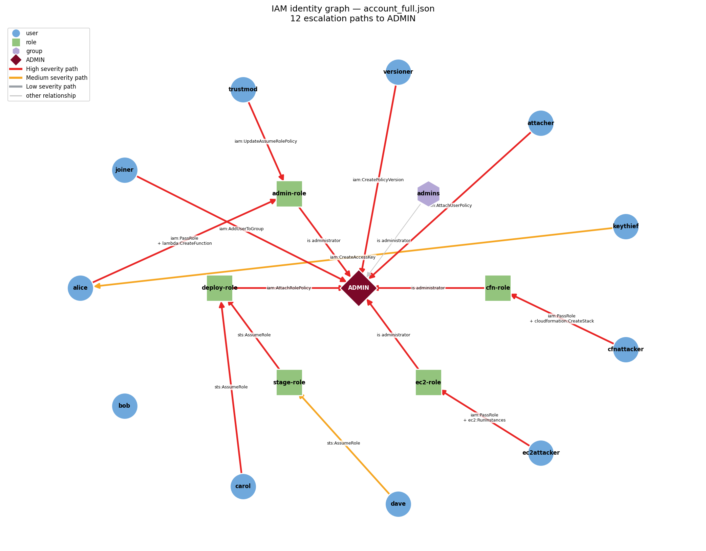

# IAM Privilege-Escalation Graph Analyzer
By _Dhruba Das, Lisa Engström, Mukunth Sriram, Nils Malmberg_
## General Introduction of the Project
Permissions in AWS are managed through IAM, which decides what every user, role, and service is allowed to do. On paper this sounds simple: you write policies that say “this person can do that thing,” and AWS enforces them. In practice, accounts grow to hundreds of users and roles, each with a handful of policies, and nobody can hold the whole picture in their head. Permissions that look harmless on their own start to interact in ways no one intended.

The problem we wanted to tackle is privilege escalation. This is when someone who was only given limited access manages to turn that access into much more, often all the way to full administrator, without anyone ever handing them admin rights. The reason it’s easy to miss is that the dangerous part is rarely a single permission. It’s a combination. An example: being allowed to create a Lambda function is fine, and being allowed to pass a role to a service is fine, but put them together and you can create a function, attach an admin role to it, and run code as that admin role. Neither permission looks alarming in a review. The chain does.

Reviewing policies one at a time doesn’t catch this, because the danger lives in the relationships between identities, not inside any one of them. That’s the idea behind this project. Instead of checking policies individually, we model the whole account as a graph, every user and role is a node, and we draw a connection whenever one identity can take control of another, a similar approach is used by PMapper (Steringer, 2018). Once the account is a graph, finding an escalation becomes a path finding problem: is there a route from an ordinary user to administrator? If there is, the tool reports it, along with each step in the chain and the specific permission that made that step possible.

The tool reads a set of IAM policies, builds this graph, and runs a set of 23 known escalation techniques against it. These aren’t invented; they’re documented methods that security researchers have published and that real attackers use (Gietzen, 2018). For each path it finds, it works out how serious it is based on how many steps the attacker needs and how much power they end up with, and labels it High, Medium, or Low so that whoever is reviewing the account knows what to fix first. Finally it draws the result as a diagram, with the dangerous paths highlighted.

We tested the tool against two kinds of accounts we built ourselves: one deliberately seeded with an escalation path for every technique, and a clean one with none. On the first it found every planted path; on the second it raised no false alarms. This matters because being quiet on safe setups is as important as catching the real problems.
### Problem Statement
In AWS, access is controlled through IAM policies attached to users, roles and groups. As an account grows, the number of identities and policies quickly becomes too large for anyone to keep a full overview, and permissions that look harmless on their own can combine in ways not intended. This creates the risk of privilege escalation, where an identity with limited access manages to gain far greater access, often full administrator rights, without ever being granted them directly. Because the danger lies in the relationships between identities rather than in any single policy, the common practice of reviewing policies one at a time fails to reveal it. The problem this project addresses is how to automatically detect these hidden escalation paths across an entire account, show each step and the permission that makes it possible, and rank the findings by severity.

## Documentation of Project
Detect hidden privilege-escalation paths in AWS IAM through graph-based analysis.

IAM permissions are usually reviewed one policy at a time, but real escalation
comes from *combinations* of individually reasonable-looking permissions spread
across users, roles, and groups. This tool models an entire account as a directed
graph of "who can gain control over whom," runs 23 documented escalation
techniques against it, follows multi-hop chains, ranks each finding by severity,
and renders the result.




*Escalation paths detected in a sample account: red = High, orange = Medium, gray = no path; each edge is labeled with the IAM permission that enables the hop.*


### Features

- **23 escalation techniques** across five families (policy self-grant, credential
  theft, trust-policy manipulation, PassRole-to-compute, role chaining); the Rhino Security Labs catalogue (Gietzen, 2018), the same set PMapper (Steringer, 2018) and Pacu (Rhino Security Labs, 2018) implement.
- **Multi-hop detection**: escalation is a path search to an `ADMIN` node, so
  chains no single rule describes (e.g. *assume a role that can make itself admin*)
  are found automatically. Only the shortest path per identity is reported, so an
  identity with more than one route to admin will only show one of them.
- **Risk scoring**: every path is labeled High / Medium / Low. In practice the
  label comes from the hop count alone: 1–2 hops is High, 3 or more is Medium.
  `severity()` also takes a blast-radius argument (read, write, admin), but every
  finding is by definition a path to admin, so `graph_analyser` always passes
  `"admin"` and the other two levels do not occur in a normal run.
- **Graph visualization**: findings rendered with severity-colored, permission-
  labeled edges.
- **Tested**: 100% precision and recall with zero false positives on synthetic
  fixtures; all 23 rules exercised. See Limitations for what that does and does
  not show.

### Pipeline

| Stage | File | What it does |
|-------|------|--------------|
| 1. Parse | `parser.py` | IAM policy JSON → queryable permission facts (`allows()`) |
| 2. Graph | `graph_analyser.py` | build the "who can control whom" graph + path search |
| 3. Rules | `rules.py` | 23 escalation-technique rules |
| 4. Score | `scoring.py` | High / Medium / Low per path |
| 5. Visualize | `visualize.py` | render the severity graph to PNG |

## Documentation for Testing
### Install
(Requires Python 3.9 or newer)

```bash
git clone https://github.com/mukunth2004/IAM-privilege-escalation-analyzer.git
cd IAM-privilege-escalation-analyzer
python3 -m venv venv
source venv/bin/activate        # on Windows: venv\Scripts\activate
pip install -r requirements.txt
```

`networkx` is needed for the graph stage and `matplotlib` only for the visualization. The parser, the rule engine and the scoring have no third-party dependencies.

### Usage
Run the commands from the repository folder.

```bash
# Print the escalation paths in an account, ranked by severity
python3 graph_analyser.py account_full.json

# Draw the findings as a coloured graph and save it as a PNG
python3 visualize.py account.json escalation_graph.png

# Show how the parser reads a single policy
python3 demo_parser.py

# Run the evaluation on the test fixtures
python3 evaluate.py
```

If no file is given, `graph_analyser.py` and `visualize.py` use `account.json`.

#### Input format

A single JSON file that lists the account's identities and their policies. It is a simplified version of the output of `aws iam get-account-authorization-details`:

```json
{
  "account_id": "123456789012",
  "identities": [
    {
      "name": "alice",
      "type": "user",
      "policy": { "Statement": [
        { "Effect": "Allow", "Action": "lambda:CreateFunction", "Resource": "*" },
        { "Effect": "Allow", "Action": "iam:PassRole",
          "Resource": "arn:aws:iam::123456789012:role/admin-role" }
      ] }
    }
  ]
}
```

Each identity has a `name`, a `type` (`user`, `role` or `group`) and a `policy`. Roles can also have a `trust_policy` that says who is allowed to assume them.

Each policy statement can use `Effect`, `Action` or `NotAction`, and `Resource` or `NotResource`. `Action` and `Resource` can be a single string or a list. Wildcards follow IAM rules, where `*` matches any characters and `?` matches exactly one. A `Condition` block is read but not evaluated, so a conditional Allow is treated as always applying.

Note: the account ID is currently fixed to `123456789012` in `rules.py`, so resource ARNs in the input must use that ID.

#### Example output

```
[High  ] (2-hop) alice
        --[ iam:PassRole + lambda:CreateFunction (run as admin-role via lambda) ]-->  admin-role
        --[ is administrator ]-->  effective ADMIN

[Medium] (3-hop) dave
        --[ sts:AssumeRole ]-->  stage-role
        --[ sts:AssumeRole ]-->  deploy-role
        --[ iam:AttachRolePolicy (attach AdministratorAccess to self) ]-->  effective ADMIN
```

### Escalation techniques
The rules are based on the techniques documented by Gietzen (2018).

| Family | Rules |
|--------|-------|
| A: Policy / self-grant | AttachUser/Role/GroupPolicy, PutUser/Role/GroupPolicy, CreatePolicyVersion, SetDefaultPolicyVersion, AddUserToGroup |
| B: Credential theft | CreateAccessKey, CreateLoginProfile, UpdateLoginProfile |
| C: Trust-policy manipulation | UpdateAssumeRolePolicy |
| D: PassRole-to-compute | Lambda, EC2, CloudFormation, Glue, DataPipeline, SageMaker, CodeBuild, ECS, UpdateFunctionCode |
| E: Role chaining | AssumeRole |

Adding a technique means writing one `@rule`-decorated function in `rules.py`.

### Testing

```bash
python3 make_fixtures.py   # rebuild the fixtures (only needed after changing make_fixtures.py)
python3 evaluate.py        # run the evaluation on both fixtures
```

| Fixture | Precision | Recall | False positives | Rules exercised |
|---------|-----------|--------|-----------------|-----------------|
| vulnerable (25 planted chains) | 100% | 100% | 0 | 23 / 23 |
| clean baseline | 100% | 100% | 0 | 0 / 23 |

The clean baseline includes deliberate "near miss" identities (half a chain) to guard against false positives.

`evaluate.py` exits with code 0 when there are no false positives or false negatives, and 1 otherwise.

#### Testing the parser
`demo_parser.py` loads `alice_policy.json` and checks that the parser handles actions given as a list, permissions scoped to one resource, `Deny` overriding `Allow`, default deny and a `NotAction` policy. The expected answers are:

```
create a lambda?             True
pass the admin-role?         True
pass a different role?       False
delete a role? (Deny wins)   False
read an S3 bucket?           False
launch an EC2 instance?      True
attach a policy? (excluded)  False
can do everything?           False
```

### Limitations

The tool performs static analysis, meaning it reasons about the policies as written rather than testing them against a live AWS account. `NotAction` and `NotResource` elements are supported, but IAM condition keys (apart from the planned OIDC rules), service control policies and permission boundaries are not yet evaluated. A `Condition` block is read but ignored, so a conditional Allow is treated as always applying. Because these features can grant or restrict access, the results may differ from what AWS would actually allow: a reported path could in practice be blocked, and some real paths may go undetected. In addition, the input is a simplified version of the output from `aws iam get-account-authorization-details`, and the evaluation was carried out only on synthetic accounts built by us, so the 100% precision and recall reported above may not carry over to real accounts.

The project does not currently include a sandbox, so none of its findings are verified against a real AWS environment. A sandbox would make it possible to recreate an account's identities and policies in an isolated setting and attempt each reported escalation path, confirming whether it actually works in real life. Without this step, the tool cannot tell a genuine path apart from one that AWS would block in practice, nor can it catch paths missed because of the blind spots described above. Adding such a verification stage is therefore the main way these limitations could be addressed.

### Future work
The most important next step is the sandbox verification stage described above, which would confirm each reported path by actually proving it. Alongside this, the static analysis could be extended to evaluate IAM condition keys, service control policies and permission boundaries, bringing the results closer to how AWS actually decides access. Since the parser already reads each statement’s `Condition` block, evaluating condition keys is a natural first step. The planned OIDC rules mentioned in the limitations belong to this same effort.

Beyond accuracy, the tool could be made easier to use on real accounts. Accepting the full output of `aws iam get-account-authorization-details`, rather than a simplified version, would let it run directly on exported account data, and testing it on real or larger accounts would show whether the results from the synthetic fixtures hold in practice. Finally, because each technique is a single `@rule` function in `rules.py`, the catalogue can grow as security researchers publish new escalation methods, keeping the tool relevant as AWS adds new services and permissions.

## AI Usage
AI/LLM was used to generate introduction comments to the top of some code files, the starting docstring that is, to make co-work and handing over code easier. AI was also used to check over some language of the readme. Github also auto fills some readme commit messages with AI generated summaries of the changes, so some commit messages are AI generated.

## References
1. Gietzen, S. (2018) *AWS IAM Privilege Escalation – Methods and Mitigation*. Rhino Security Labs. Available at: https://rhinosecuritylabs.com/aws/aws-privilege-escalation-methods-mitigation/

2. Rhino Security Labs (2018) *Pacu: The AWS exploitation framework* [Computer program]. Available at: https://github.com/RhinoSecurityLabs/pacu

3. Steringer, E. (2018) *Principal Mapper (PMapper)* [Computer program]. NCC Group. Available at: https://github.com/nccgroup/PMapper

## Contribution per group member (~0.5 pages with own contribution)
### Mukunth
I was responsible for building the rule engine (rules.py) and the test account data (account_full.json). The rule engine is where the actual escalation detection happens. I went through the Rhino Security Labs catalogue and implemented each technique as its own function, 23 in total across the five families (policy self-grant, credential theft, trust-policy manipulation, PassRole-to-compute, and role chaining). Each rule checks whether a given identity has the right combination of permissions to escalate, and if so, adds an edge to the graph. Getting the edge cases right took some iteration, especially around PassRole rules where you need both iam:PassRole on a specific role ARN and the corresponding compute permission (like lambda:CreateFunction or ec2:RunInstances) to actually exploit it. For the test data, I built account_full.json with around 18 identities that cover all 23 techniques, making sure each rule had at least one identity that triggers it, but also that identities with only half the required permissions don’t produce false positives.
### Nils
I was responsible for the sample accounts the tool is run against (account.json, account_full.json and alice_policy.json) and for verifying that they exercise the rules as intended. account.json is the small account used for the main demo and the example graph in this README. It has seven identities and is deliberately kept readable: one admin role, a deploy role that can make itself admin, a stage role that can assume the deploy role, and a few users that reach admin by different routes. It is short enough to follow by hand, which is what makes it useful for showing the idea, and it exercises 13 of the 23 rules. account_full.json is the same account grown to cover every family of technique, with 17 identities. The point of it is coverage rather than readability: it is the file to point at when the question is whether the rule engine is reached at all, and it is the input for the larger example renders in docs/.
### Dhruba
I was responsible for the parser (`parser.py`) and the script for its demo (`demo_parser.py`), as well as the writing the Documentation for Testing section of the `README`. I also added functionality to the parser which now handles `NotAction` and `NotResource` (i.e. "everything except..." statements). In the first version, those statements were silently ignored, which meant that a policy like AWS's PowerUserAccess looked as if it granted nothing at all. `parser.py` now also follows IAM's own wildcard rules (`*` and `?` only) instead of Python's filename matching (`fnmatch`), which treated the square-bracket characters specially; this way the parser matches actions and resources the same way AWS itself does. I also made the parser store each statement's `Condition` block, so that condition keys can be evaluated in the future, even though they are not evaluated yet. I then updated `demo_parser.py` so that it runs from any folder and shows a `NotAction` example.
### Lisa
We divided the work between us at the start and my contributions to the project were the graph analysis and visualisation Python scripts, as well as the problem statement, limitations and future work sections of this README. In `graph_analyser.py`, I built the stage that turns the parsed permissions into a graph of who can take control of whom. Each user and role is a node, and an edge is added whenever one identity can take over another, labelled with the permission that allows it. Modelling the account this way turns the search for privilege escalation into a path finding problem, which is the core idea of the project. The tool then searches for paths to an `ADMIN` node, which means it can find escalation chains of several steps, including ones that no single rule describes on its own, and prints the results ranked by severity. Each finding lists every step in the chain together with the permission behind it, so a reviewer can see exactly how the escalation would happen. The `visualize.py` script draws these findings as a graph and saves it as a PNG image, it was really finiky to get the graph legible but I think it worked out quite nicely in the end. Paths are coloured red for High and orange for Medium, identities without a path are shown in grey, and every edge is labelled with the IAM permission that enables it and the ADMIN in the middle for a clear goal. Finally, I wrote the problem statement, the limitations and the future work section of this README, which together explain why the tool is needed, where it currently falls short and how the project could be taken from here.
